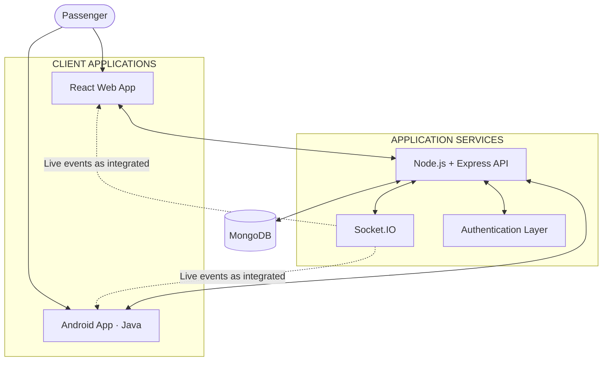

<div align="center">

# TRANSITFLOW

### Your bus. Your time.
**A smarter way to move through the city.**

A connected public transportation platform focused on bus visibility, route discovery, and a clearer passenger experience.


[Preview](#-the-interface) · [Architecture](#-system-architecture) · [Setup](#-getting-started) · [Roadmap](#-development-roadmap)

</div>

---

## ◈ The idea

Public transport should be easier to understand before a passenger even reaches the bus stop.

**TransitFlow** is a smart transportation project designed to bring bus information into one accessible experience. The platform combines a map-oriented interface, route and stop discovery, and a backend foundation for connected transport data.

The goal is simple: reduce uncertainty around everyday bus journeys and make public transport information easier to access.

## ◈ The interface

The current web experience uses a clean, map-first layout with a focused visual hierarchy: clear navigation, a strong call to action, network statistics, and a dedicated live-network panel.

<div align="center">

### 01 — Landing experience


*TransitFlow home page — network overview and map-focused bus panel.*

<br>

### 02 — Alternate viewport


*TransitFlow interface — alternate viewport capture.*

</div>

> These screenshots show the current interface. Actual live tracking depends on a connected GPS/location feed and backend updates; a displayed map marker or sample coordinate by itself does not guarantee continuous real-time tracking.

## ◈ What it is being built to do

| Capability | Purpose |
|---|---|
| **Bus visibility** | Display buses and their reported locations on a map. |
| **Route discovery** | Help passengers explore available routes. |
| **Stop information** | Make important stops easier to find. |
| **Bus details** | Associate bus identifiers with route information. |
| **Authentication foundation** | Support user registration and protected access. |
| **Connected clients** | Build toward a web and Android passenger experience. |
| **Real-time foundation** | Provide event-based communication as live updates are integrated. |

## ◈ Technology constellation

<div align="center">


</div>

| Layer | Technologies |
|---|---|
| Web application | React, React Router, CSS |
| Interactive maps | React Leaflet, Leaflet, OpenStreetMap |
| Backend API | Node.js, Express |
| Data layer | MongoDB, Mongoose |
| Real-time communication | Socket.IO |
| Authentication foundation | JSON Web Tokens (JWT), bcryptjs |
| Android application | Java, Android SDK, Android Studio |
| Configuration | dotenv, environment variables |

## ◈ System architecture



The web and Android clients are designed to communicate with a shared backend. The API handles application requests, MongoDB stores persistent data, and Socket.IO provides the foundation for event-driven updates.

## ◈ Getting started

The commands below are a setup guide. Run them from the corresponding application directory in your local repository.

### Prerequisites

- Node.js and npm
- MongoDB local instance or MongoDB Atlas account
- Git
- Android Studio (for the Android client)

### 1. Get the source

```bash
git clone https://github.com/YOUR_USERNAME/TransitFlow.git
cd TransitFlow
```

Replace `YOUR_USERNAME` and the repository name with your actual GitHub details.

### 2. Start the backend

```bash
cd backend
npm install
```

Create a `.env` file inside the backend directory:

```env
PORT=5000
MONGO_URI=your_mongodb_connection_string
JWT_SECRET=your_long_random_secret
```

Start the server using the script configured in your `package.json`. For example:

```bash
npm run dev
```

If no `dev` script exists, use the start command defined by your project (for example, `node server.js`).

Backend base URL:

```text
http://localhost:5000
```

### 3. Start the web application

Open a second terminal:

```bash
cd frontend
npm install
npm run dev
```

If the frontend uses a different directory name, enter that directory instead.

If your frontend reads the API URL from Vite environment variables, configure:

```env
VITE_API_URL=http://localhost:5000
```

Open the local development URL printed in the terminal.

### 4. Run the Android application

1. Open the Android project in Android Studio.
2. Wait for Gradle sync to finish.
3. Start an emulator or connect an Android device.
4. Run the application.

**Android emulator note:** `localhost` inside an emulator points to the emulator itself. To reach a backend running on your development computer, the standard Android Emulator host alias is `10.0.2.2` (for example, `http://10.0.2.2:5000`).

## ◈ Repository layout

Your actual repository may keep the web, backend, and Android applications in separate folders or repositories. The following is an illustrative combined layout; adjust it to match your source tree.

```text
TransitFlow/
├── frontend/
│   └── src/
│       ├── components/
│       ├── pages/
│       ├── data/
│       └── App.jsx
│
├── backend/
│   ├── models/
│   ├── routes/
│   ├── middleware/
│   ├── server.js
│   └── .env.example
│
├── android/
│   └── app/
│
├── docs/
│   └── images/
│       ├── transitflow-home.png
│       └── transitflow-home-layout.png
│
└── README.md
```

## ◈ Configuration & security

| Variable | Role |
|---|---|
| `PORT` | Port used by the backend server |
| `MONGO_URI` | MongoDB connection string |
| `JWT_SECRET` | Secret used to sign authentication tokens |

Security essentials:

- Keep `.env` out of Git; add it to `.gitignore`.
- Commit an `.env.example` with placeholder values only.
- Never publish database credentials, tokens, or private keys.
- Hash passwords; never store plain-text passwords.
- Validate incoming data and protect private routes.
- Use HTTPS and secure production configuration when deploying.

## ◈ Development roadmap

- [x] Design and build the initial web landing experience
- [x] Integrate the map interface
- [x] Establish the Node.js and Express backend
- [x] Connect MongoDB
- [x] Build the initial authentication foundation
- [x] Create the Android application foundation
- [ ] Complete end-to-end integration across clients and API
- [ ] Connect continuous GPS location updates
- [ ] Implement live bus update delivery
- [ ] Add arrival-time estimation
- [ ] Expand route and stop management
- [ ] Deploy and monitor the production application

*Update the checklist as each feature is completed and tested.*

## ◈ Contributing

Ideas, feedback, and improvements are welcome.

1. Fork the repository.
2. Create a feature branch: `git checkout -b feature/your-feature`
3. Commit your changes: `git commit -m "Add your feature"`
4. Push the branch: `git push origin feature/your-feature`
5. Open a Pull Request describing your changes.

## ◈ Project

**TransitFlow**  
A smart mobility project by **Arjit**  
B.Tech · Computer Science & Engineering

- **Portfolio:** [new-animation-portfolio.vercel.app](https://new-animation-portfolio.vercel.app/)
- **GitHub:** [Add your GitHub profile](https://github.com/YOUR_USERNAME)

Replace the GitHub placeholder with your actual profile URL before publishing.

## ◈ License

No license has been specified yet. If you plan to make this repository open source, add a `LICENSE` file and choose a license that matches how you want others to use the project.

---

<div align="center">

### TRANSITFLOW
**Your bus. Your time.**

*Designed to make the journey clearer, one stop at a time.*

</div>
