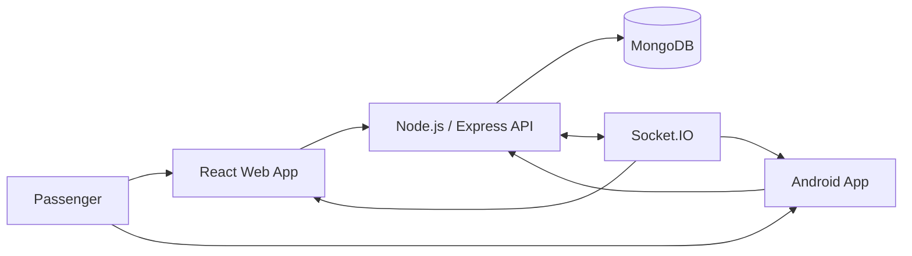

::: {align="center"}
# TransitFlow

### Your bus. Your time.

A smart public transportation platform designed to make everyday bus
travel more predictable with live bus tracking, route discovery, and
stop information.

```{=html}
<p>
```
``{=html}
``{=html}
``{=html}
```{=html}
</p>
```
[Overview](#-overview) · [Features](#-key-features) · [Tech
Stack](#-technology-stack) · [Getting Started](#-getting-started) ·
[Project Structure](#-project-structure)
:::

------------------------------------------------------------------------

## 🚌 Overview

**TransitFlow** is a real-time public transportation tracking project
built to help passengers make informed travel decisions. It brings bus
locations, routes, and stops together in one clean interface.

The project is being developed as a connected ecosystem consisting of a
web application, a backend API, and an Android application.

### The problem

Passengers often have limited information about where their bus is,
which route it follows, and when it may arrive. This uncertainty can
lead to unnecessary waiting and a frustrating travel experience.

### The solution

TransitFlow aims to provide a single place where passengers can:

-   View buses and their reported locations.
-   Explore available routes and stops.
-   Follow a bus on a map.
-   Access transport information through a simple interface.

## ✨ Key Features

  -----------------------------------------------------------------------
  Feature                             Description
  ----------------------------------- -----------------------------------
  Live bus map                        Map interface for viewing bus
                                      locations.

  Route discovery                     Browse available bus routes and
                                      their details.

  Stop information                    View important stops across the
                                      network.

  Bus details                         Identify buses and their assigned
                                      routes.

  User authentication                 Registration and login foundation
                                      for user access.

  Responsive web UI                   Clean interface designed for
                                      desktop and smaller screens.

  Android application                 Android client developed alongside
                                      the web platform.
  -----------------------------------------------------------------------

> **Development note:** Features and data availability depend on the
> current integration state. Live location updates require an active
> device/location feed and backend connection; a map marker or demo
> coordinate alone does not represent continuous GPS tracking.

## 🖥️ Preview

The web landing page introduces the transport network, highlights key
service statistics, and displays a map-focused bus tracking panel.

```{=html}
<!-- Replace this with a screenshot committed to your repository, for example: docs/images/transitflow-home.png -->
```
```{=html}
<!--  -->
```
## 🧰 Technology Stack

### Web frontend

-   **React** --- component-based user interface.
-   **React Router** --- client-side navigation.
-   **React Leaflet** --- interactive map integration.
-   **Leaflet** --- map rendering.
-   **CSS** --- layout, styling, and responsive presentation.

### Backend

-   **Node.js** --- JavaScript runtime.
-   **Express** --- REST API.
-   **MongoDB** --- database.
-   **Mongoose** --- MongoDB object modelling.
-   **Socket.IO** --- real-time, event-based communication foundation.
-   **JWT** --- token-based authentication foundation.
-   **bcryptjs** --- password hashing.
-   **dotenv** --- environment configuration.

### Android

-   **Java**
-   **Android SDK**
-   **Android Studio**

### Maps

-   **OpenStreetMap** map data
-   **Leaflet** map library

## 🏗️ High-Level Architecture



The clients communicate with the backend API. MongoDB stores application
data, while Socket.IO provides the communication layer for real-time
features as they are integrated.

## 🚀 Getting Started

Follow the sections for the part of the project you want to run.

### Prerequisites

Install the following tools:

-   Node.js (LTS recommended)
-   npm
-   MongoDB database (local or MongoDB Atlas)
-   Git
-   Android Studio (only if you want to run the Android application)

### 1. Clone the repository

``` bash
git clone https://github.com/YOUR_USERNAME/TransitFlow.git
cd TransitFlow
```

Replace `YOUR_USERNAME` with your GitHub username and adjust the
repository name if yours is different.

### 2. Run the backend

Open a terminal in the backend directory:

``` bash
cd backend
npm install
```

Create a `.env` file in the backend directory:

``` env
PORT=5000
MONGO_URI=your_mongodb_connection_string
JWT_SECRET=replace_with_a_long_random_secret
```

Start the development server:

``` bash
npm run dev
```

If your `package.json` does not define a `dev` script, use the start
command configured in that file (for example, `node server.js`).

The API should be available at:

``` text
http://localhost:5000
```

### 3. Run the web frontend

Open another terminal and move to the frontend directory:

``` bash
cd frontend
npm install
npm run dev
```

If the frontend uses a different folder name in your repository, use
that directory instead.

Configure the frontend API URL in its environment file if your app
expects one:

``` env
VITE_API_URL=http://localhost:5000
```

Open the local URL printed by Vite in your terminal.

### 4. Run the Android application

1.  Open the Android project folder in Android Studio.
2.  Allow Gradle sync to complete.
3.  Select an emulator or connect an Android device.
4.  Run the app using the **Run** button.

Make sure the Android app points to a backend address reachable from the
device. For an Android emulator, `localhost` refers to the emulator
itself; use the emulator's host-machine address (commonly `10.0.2.2`)
when connecting to a backend running on your computer.

## ⚙️ Environment Variables

Keep secrets out of Git. A typical backend `.env` file may contain:

  Variable       Purpose
  -------------- --------------------------------------------
  `PORT`         Backend server port.
  `MONGO_URI`    MongoDB connection string.
  `JWT_SECRET`   Secret used to sign authentication tokens.

Use your actual variable names if they differ. Add `.env` to
`.gitignore` and commit an `.env.example` containing placeholders only.

## 📁 Project Structure

The exact folder names may differ depending on how the repositories are
arranged. A suggested combined structure is:

``` text
TransitFlow/
├── frontend/             # React web application
│   ├── public/
│   └── src/
│       ├── components/
│       ├── pages/
│       ├── data/
│       └── App.jsx
│
├── backend/              # Node.js and Express API
│   ├── models/
│   ├── routes/
│   ├── middleware/
│   ├── server.js
│   └── .env.example
│
├── android/              # Android application
│   └── app/
│
├── docs/                 # Screenshots and project documentation
└── README.md
```

## 🔐 Security

-   Never commit `.env` files, database credentials, JWT secrets, or
    private keys.
-   Store passwords using a secure password-hashing algorithm.
-   Validate and sanitize incoming API data.
-   Protect private API routes with authentication and authorization.
-   Use HTTPS when deploying the application.

## 🗺️ Roadmap

-   [x] Initial web interface and navigation
-   [x] Map interface integration
-   [x] Backend API foundation
-   [x] MongoDB connection
-   [x] Initial authentication flow
-   [x] Android application foundation
-   [ ] Complete web, backend, and Android integration
-   [ ] Connect continuous GPS location updates
-   [ ] Add live arrival estimates
-   [ ] Add route and stop management
-   [ ] Add deployment and production monitoring

Update the checklist as each feature is completed and tested.

## 🤝 Contributing

Contributions, suggestions, and bug reports are welcome.

1.  Fork the repository.
2.  Create a branch: `git checkout -b feature/your-feature`
3.  Commit your changes: `git commit -m "Add your feature"`
4.  Push the branch: `git push origin feature/your-feature`
5.  Open a Pull Request.

## 👨‍💻 Developer

**Arjit**\
B.Tech Computer Science & Engineering

-   GitHub:
    [@CodingwithArjit](https://github.com/CodingwithArjit)
-   Portfolio: [Developer
    Portfolio](https://new-animation-portfolio.vercel.app/)

Replace the GitHub placeholder with your actual profile username.

## 📄 License

This project is currently an academic and learning project. Add a
license such as MIT only if you intend to grant others the rights
described by that license.

------------------------------------------------------------------------

::: {align="center"}
**TransitFlow --- Making every bus journey easier to plan.**
:::
